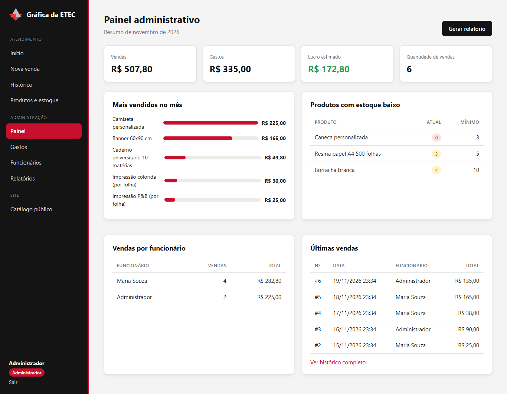

# 4º Bimestre: Sistema de Gestão para Gráfica

Sistema web para a gráfica da escola, com catálogo público, controle de estoque, registro de vendas, painel administrativo, gastos, cadastro de funcionários e relatório em PDF para a diretoria/APM.

**Integrantes:** Otávio Giovanelli Biazzi, Pedro Henrique Miranda, Laura Cristina Gonçalves da Cruz e Pedro Henrique Dalle Molle Godoi.

## Conteúdo da pasta

| Item | Descrição |
| ---- | --------- |
| [`sistema-grafica/`](sistema-grafica/) | Código-fonte do sistema (PHP, MySQL, CSS e JS) |
| [`sistema-grafica/docs/Plano_Funcionalidades.pdf`](sistema-grafica/docs/Plano_Funcionalidades.pdf) | Plano de funcionalidades entregue antes do desenvolvimento |
| [`docs/relatorio-projeto.md`](docs/relatorio-projeto.md) | Relatório do projeto, com os prints de cada funcionalidade || [`prints/`](prints/) | Prints do sistema funcionando e um exemplo do PDF gerado |
| [`declaracao-uso-de-ia.md`](declaracao-uso-de-ia.md) | DECLARAÇÃO DE USO DE INTELIGÊNCIA ARTIFICIAL |

## Como rodar

1. Copie a pasta `sistema-grafica` para `C:\xampp\htdocs\` com o nome `grafica`.
2. Ligue o **Apache** e o **MySQL** no XAMPP.
3. Copie `config/conexao.exemplo.php` com o nome `config/conexao.php`.
4. Abra `http://localhost/grafica/instalar.php` e clique em **Instalar banco de dados**.
5. Acesse `http://localhost/grafica` com `admin` / `admin123` (administrador) ou `maria` / `func123` (funcionária).

Mais detalhes estão no [README do sistema](sistema-grafica/README.md).

## DECLARAÇÃO DE USO DE INTELIGÊNCIA ARTIFICIAL

O uso de IA neste projeto está declarado em [`declaracao-uso-de-ia.md`](declaracao-uso-de-ia.md), seguindo a política do professor.
