# Relatório do projeto: Sistema de Gestão para Gráfica

**Instituição:** Etec Vasco Antônio Venchiarutti  
**Curso:** Informática para Internet (INFONET)  
**Disciplina:** Sistemas Web (SWEB)  
**Turma:** 2º D, 4º bimestre  

**Integrantes:** Otávio Giovanelli Biazzi, Pedro Henrique Miranda, Laura Cristina Gonçalves da Cruz e Pedro Henrique Dalle Molle Godoi.

## Apresentação

Neste projeto desenvolvemos um sistema de gestão para a gráfica da escola. A gráfica imprime, faz acabamentos (encadernação, plastificação), vende material escolar e produtos personalizados, e tem mais de uma pessoa trabalhando no atendimento. O sistema reúne em um só lugar o catálogo, o estoque, as vendas, os gastos, os funcionários e o relatório financeiro para a diretoria e a APM.

Antes de programar, entregamos o [plano de funcionalidades](../sistema-grafica/docs/Plano_Funcionalidades.pdf), que define os níveis de acesso, as funcionalidades e os dados guardados no banco. O sistema foi construído seguindo esse plano, item por item.

## Objetivo

Criar um sistema web de uso interno (rede local da escola) em que:

- o público consulta os produtos e serviços sem precisar de login;
- os funcionários registram vendas e cuidam do estoque;
- o administrador acompanha os resultados, registra gastos, gerencia as contas e gera o relatório em PDF.

## Metodologia

Primeiro estudamos como a gráfica funciona e o que é um sistema de gestão, e transformamos isso no plano de funcionalidades. Depois modelamos o banco de dados com as cinco tabelas previstas no plano (usuários, produtos, vendas, itens da venda e gastos) e dividimos as telas entre os integrantes:

| Integrante | Partes desenvolvidas |
| ---------- | -------------------- |
| Otávio Giovanelli Biazzi | Estrutura do projeto, conexão PDO, funções gerais, login e níveis de acesso, registro de vendas, instalador e documentação |
| Pedro Henrique Miranda | Layout e CSS, cabeçalho e menu, página inicial, catálogo público e versão para celular |
| Pedro Henrique Dalle Molle Godoi | Produtos e estoque, fotos dos produtos e histórico de vendas |
| Laura Cristina Gonçalves da Cruz | Painel administrativo, gastos, funcionários, relatório em PDF e este relatório |

O sistema foi feito em PHP 8 com PDO, MySQL, HTML, CSS e JavaScript, sem frameworks, rodando no XAMPP. Para gerar o PDF usamos a biblioteca gratuita FPDF. A cada parte pronta testávamos as telas no navegador com os dois tipos de conta.

Durante o desenvolvimento foram utilizadas ferramentas de Inteligência Artificial como apoio para gerar imagens de referência do layout, ajudar no desenvolvimento e na melhoria de partes do código, tirar dúvidas sobre as abordagens escolhidas e fazer uma revisão final. As respostas obtidas foram analisadas, verificadas e testadas pelo grupo. As ferramentas utilizadas, suas finalidades, etapas de utilização e formas de validação encontram-se detalhadas na **DECLARAÇÃO DE USO DE INTELIGÊNCIA ARTIFICIAL**, apresentada ao final deste relatório.

## Funcionalidades (item do plano → tela)

### 4.1 Login e níveis de acesso

Só funcionários cadastrados entram no sistema. Depois do login, o sistema identifica se a conta é de **funcionário** ou de **administrador**. As páginas de administração bloqueiam o nível básico, mesmo que a pessoa digite o endereço direto.

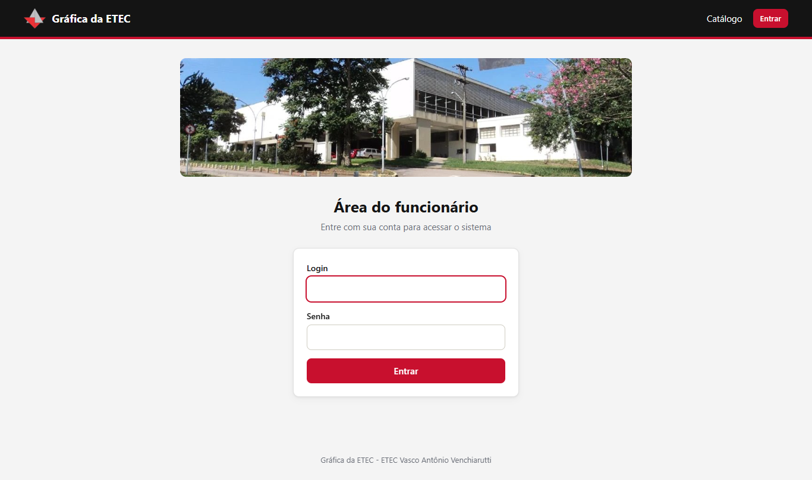

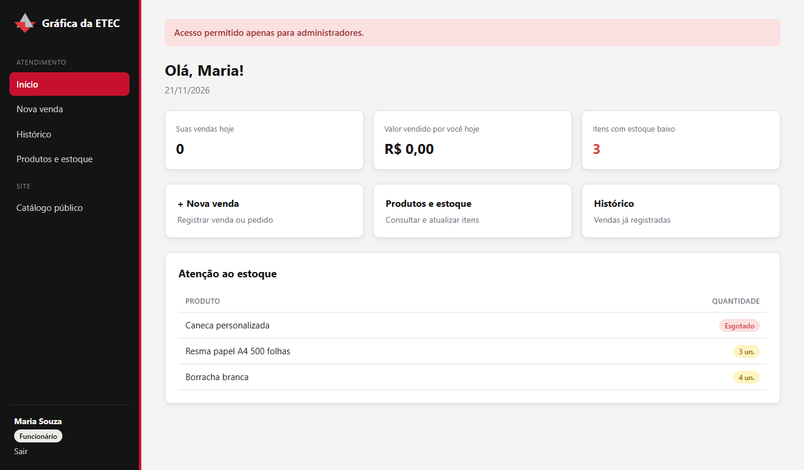

### Tela inicial

Depois do login, cada pessoa vê as próprias vendas do dia, atalhos e o aviso de estoque baixo. O menu muda conforme o nível: o funcionário não vê a parte de administração.

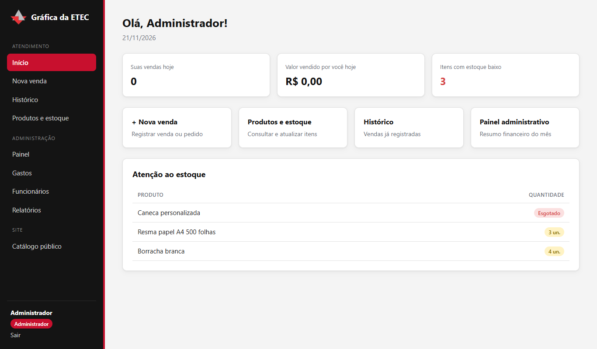

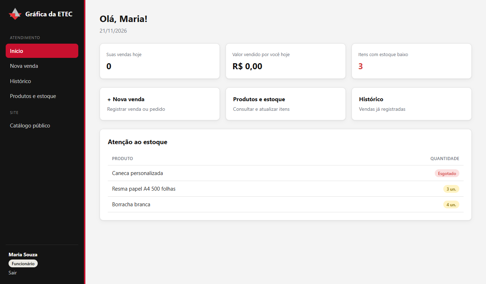

### 4.2 Catálogo interno e controle de estoque

Cadastro e edição de produtos e serviços com nome, categoria, preço, estoque, estoque mínimo e foto. Os selos mostram se o item está ok, baixo ou esgotado. Produtos não são apagados, são **inativados**, para não estragar o histórico de vendas. Só o administrador pode inativar.

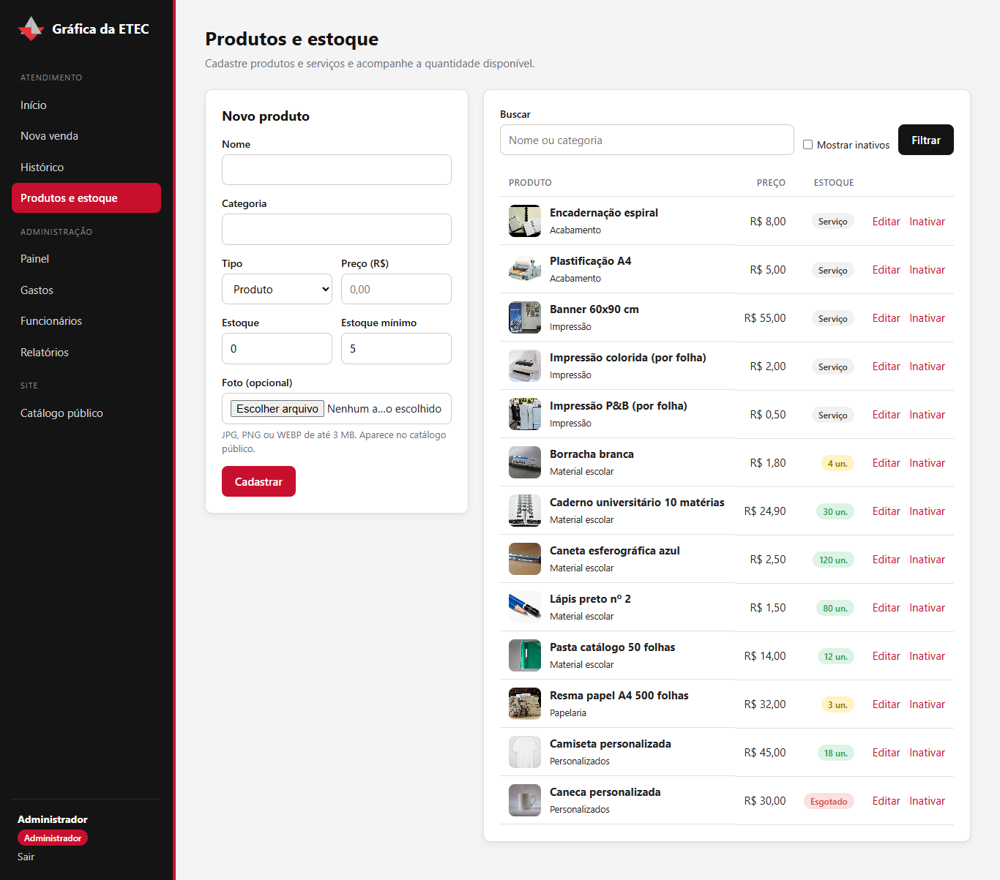

### 4.3 Catálogo público

Pode ser acessado sem login. Mostra nome, categoria, preço e se o item está disponível, sem mostrar a quantidade exata, os gastos ou o lucro.

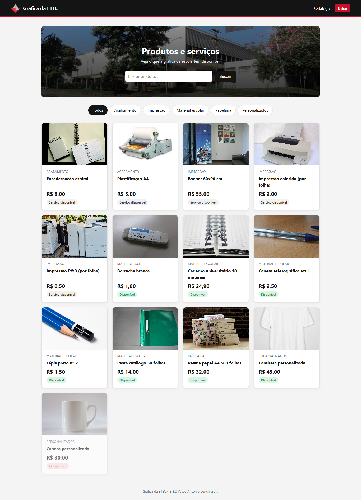

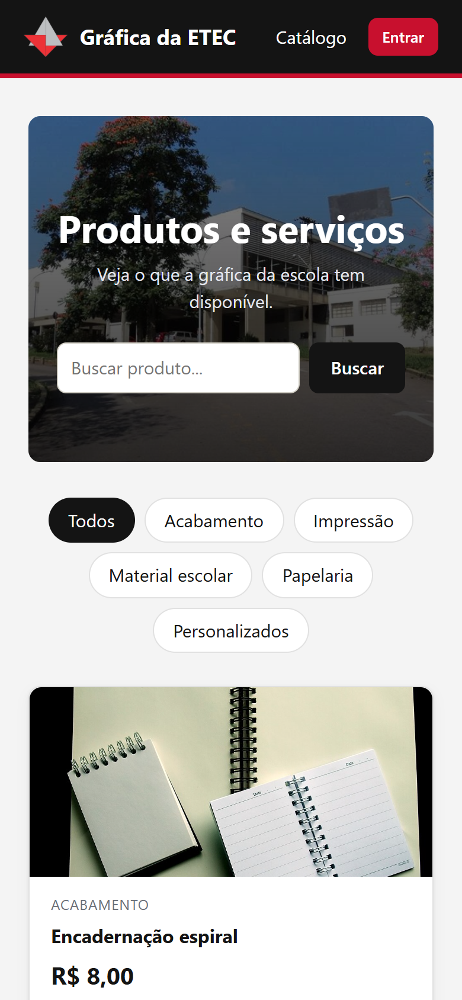

### 4.4 Registro de vendas e pedidos

O funcionário escolhe os itens e as quantidades e o sistema calcula o total. Ao confirmar, a venda, os itens e a baixa no estoque são salvos juntos, numa **transação**: ou salva tudo, ou nada. O preço sempre vem do banco, e não do navegador.

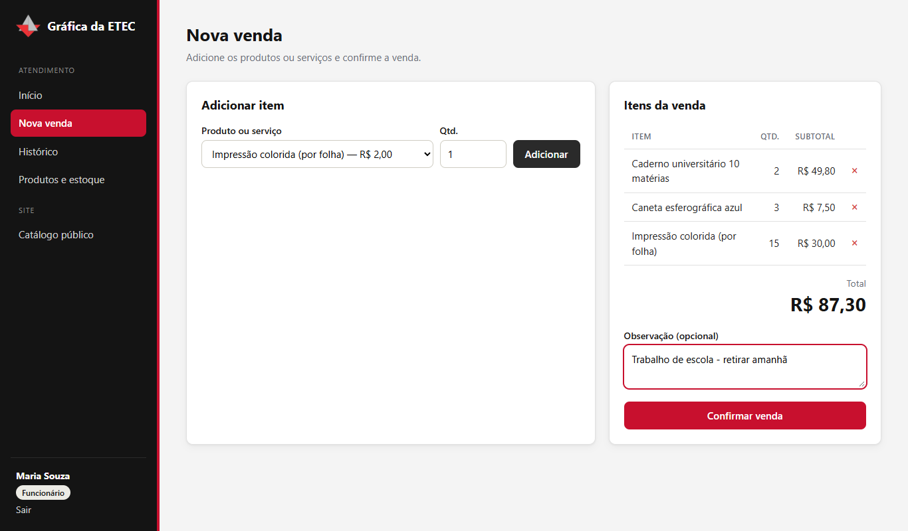

### 4.5 Histórico de vendas

Lista as vendas com data, itens, valor total e funcionário responsável, com filtro por período e por funcionário.

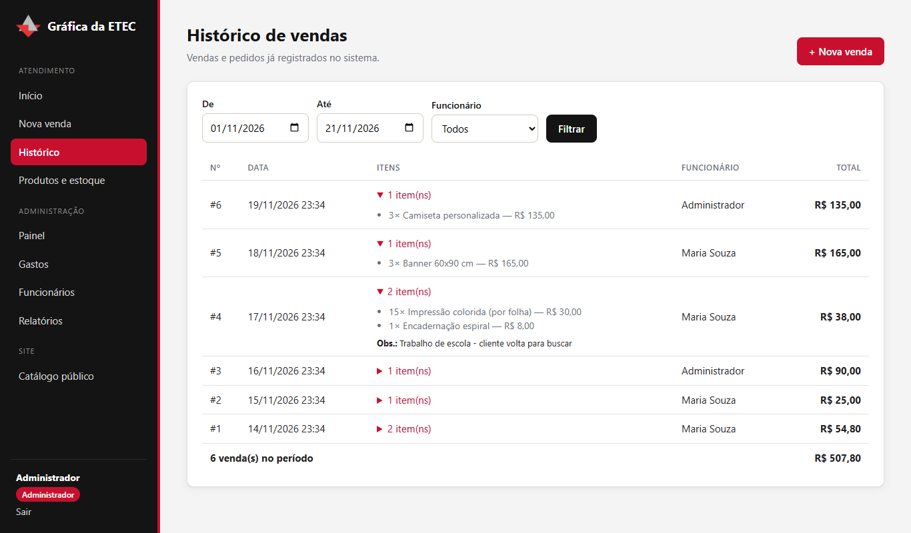

### 4.6 Painel administrativo

Resumo do mês atual: total de vendas, gastos, lucro estimado, quantidade de vendas, produtos mais vendidos, vendas por funcionário e produtos com estoque baixo.

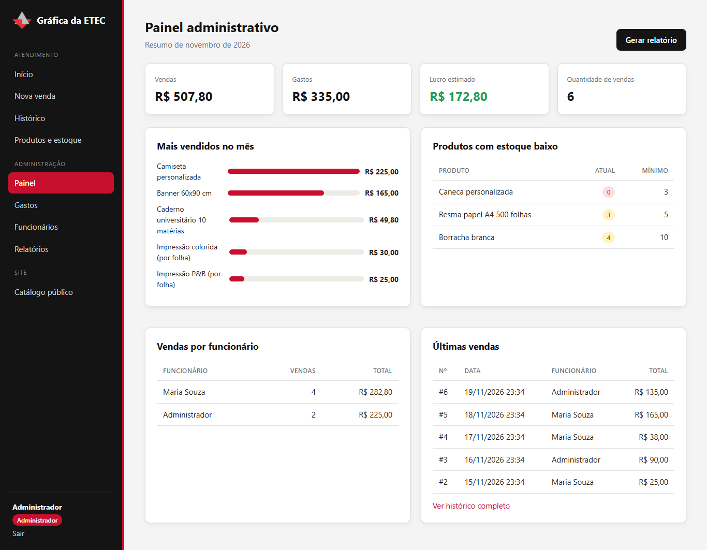

### 4.7 Registro de gastos

O administrador registra cada gasto com descrição, valor, data e categoria. Os gastos entram no painel e no relatório.

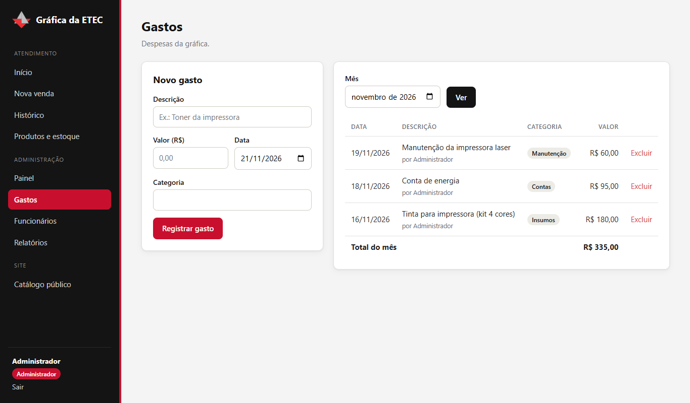

### 4.8 Cadastro de funcionários

Só o administrador cadastra, edita, altera o nível de acesso e desativa contas. As senhas são guardadas com `password_hash()`. Uma conta desativada perde o acesso na hora.

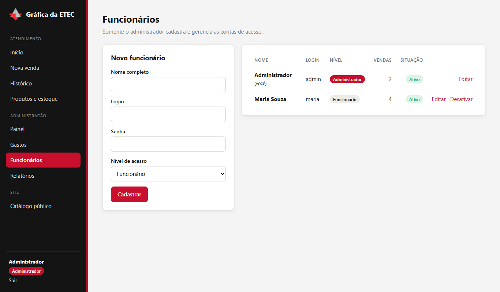

### 4.9 Relatórios em PDF

O administrador escolhe o período, vê uma prévia e baixa o PDF com vendas, gastos, lucro estimado, mais vendidos e vendas por funcionário. O envio para a diretoria ou a APM não é automático, como definido no plano: o responsável baixa o arquivo e encaminha, por exemplo, por e-mail.

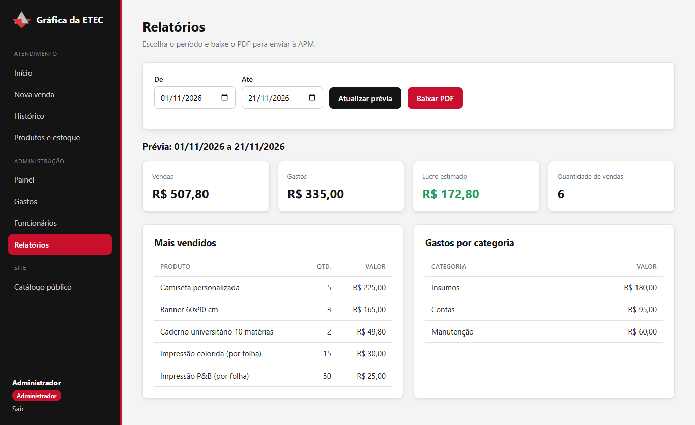

Exemplo de PDF gerado: [14-relatorio-exemplo.pdf](../prints/14-relatorio-exemplo.pdf)

## Segurança

- Senhas salvas com `password_hash()` e conferidas com `password_verify()`.
- Todas as consultas usam *prepared statements* (proteção contra SQL Injection).
- Todo texto exibido passa por `htmlspecialchars()` (proteção contra XSS).
- Upload de foto confere o tipo real da imagem e o tamanho máximo.
- O instalador do banco só funciona no próprio computador do servidor.

## Limites desta versão

Como previsto no item 7 do plano, esta versão não tem pagamento on-line, envio automático de e-mail, integração com sistemas externos nem aplicativo móvel.

## Testes realizados

Rodamos o sistema no XAMPP, instalamos o banco pelo `instalar.php` e testamos todas as telas com a conta de administrador (`admin`) e com a de funcionária (`maria`). Conferimos a baixa no estoque depois de uma venda, o bloqueio de venda acima do estoque, o bloqueio das páginas de administração para o funcionário, a conta desativada perdendo o acesso, os filtros do histórico e dos gastos e a geração do PDF. Os prints deste relatório foram tirados durante esses testes.

## Conclusão

O projeto nos fez passar por todas as etapas de um sistema de verdade: entender o problema, planejar os requisitos, modelar o banco, dividir o trabalho e entregar algo que funciona. Aprendemos principalmente a pensar nos dados (o que guardar e por quê), a controlar quem pode fazer o quê e a proteger o sistema contra erros e usos indevidos.

---

A **DECLARAÇÃO DE USO DE INTELIGÊNCIA ARTIFICIAL** deste projeto está em [`declaracao-uso-de-ia.md`](../declaracao-uso-de-ia.md).
